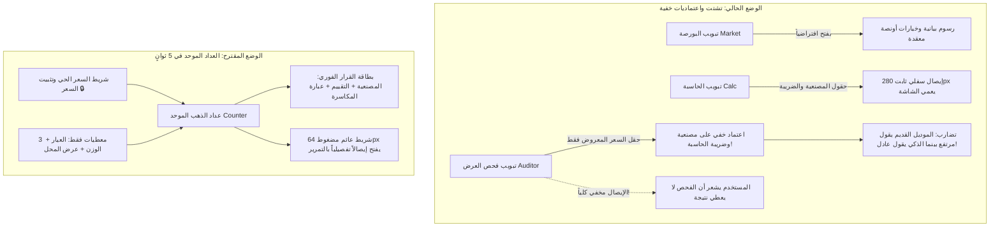

# وثيقة إعادة هندسة وتوحيد تجربة المستخدم: فحص العرض والحاسبة (Unified Gold Counter RFC)

* **المؤلف:** EGM Swarm (6 متحدثين متخصصين) & الذكاء الاصطناعي
* **التاريخ:** 2026-11-05
* **المشروع:** `gold-calc` (حاسبة الذهب الذكية - السوق السعودي)
* **الحالة:** جاهز للتنفيذ بعد المراجعة (Ready for Implementation)

---

## 1. نظرة عامة (Overview)

تهدف هذه الوثيقة إلى حل الخلل البنيوي والتجزيء المعرفي الذي يعاني منه تطبيق `gold-calc` حالياً في الفصل المصطنع بين **صفحة "فحص العرض" (Auditor)** و**صفحة "الحاسبة" (Calculator)**. 

أثبت الفحص الشامل عبر 6 عدسات متوازية لمنهجية EGM أن الشاشتين تمثلان رياضياً ووظيفياً **وجهين لمعادلة خطية واحدة**:
- **الحساب للأمام (Forward):** (الوزن × سعر الجرام) + المصنعية + 15% ضريبة = السعر الإجمالي.
- **الحساب للخلف (Reverse / Deconstruct):** السعر المعروض - (15% ضريبة + سعر الذهب الخام) = المصنعية الفعلية المستخرجة.

الفصل الحالي بينهما أدى إلى:
1. ارتباك المستخدم الميداني داخل سوق الذهب (يحتاج قراراً حاسماً في 5 ثوانٍ، بينما التطبيق يفتحه على شاشة بورصة ثم يجبره على التنقل بين تبويبين).
2. ارتهان "فحص العرض" خفياً بمدخلات افتراضية مجهولة من تبويب الحاسبة.
3. اختفاء الإيصال السفلي الذهبي كلياً عن شاشة الفحص، مما أوحى للمستخدم بأن "فحص العرض لا يعطي نتيجة بدون الصفحات الأخرى".

الحل يكمن في **توحيد الشاشتين ضمن "العداد الذكي الموحد" (Unified Gold Counter)**، بحيث تصبح عملية تدقيق عرض المحل وحساب التكلفة تجربة فورية متكاملة بـ 3 مدخلات أساسية.

---

## 2. تقرير التدقيق الفني الشامل (Synthesized Analysis across 6 Lenses)



### 🔴 القضايا الحرجة (Blockers)

#### 1. احتجاب الإيصال النهائي (`.bottom-receipt`) عن شاشة فحص العرض
- **التشخيص:** السطر 438 في `styles.css` يخفي كرت النتيجة الذهبية كلياً خارج تبويب الحاسبة:
  ```css
  main:not([data-active-tab="calc"]):not([data-active-tab="all"]) .dashboard-result { display: none !important; }
  ```
- **الأثر:** المستخدم يدخل العرض في شاشة الفحص، فيختفي الإيصال المالي الرسمي الذي يوضح تفاصيل الضريبة والدفع، وتبقى النتيجة معلقة في نصوص متفرقة داخل الصفحة دون ملخص ختامي، وهو السبب الأساسي لشكوى المستخدم المباشرة.

#### 2. تناقض النموذجين على شاشة واحدة (Model A vs Model B Collision)
- **التشخيص:** بطاقة `#comparisonPanel` تجمع بين موديولين حسابيين متعارضين:
  1. **النموذج القديم الساذج (`quote-comparison-ui.js`):** يقارن عرض المحل برقم مرجعي وهمي محسوب في `app.js` بافتراض مصنعية 35 ر.س/جم مخفية في تبويب الحاسبة!
  2. **النموذج الذكي الحديث (`auditor-ui.js` / `auditCounterQuote`):** يفكك السعر ويستخرج المصنعية الحقيقية ويصنفها وفق فئات السوق (محلي، خليجي، إيطالي، فاخر).
- **الأثر:** إذا قدم البائع خاتماً بمصنعية 55 ر.س/جم، يقول الموديل الأول باللون الأحمر: «السعر أعلى من المرجع بـ 150 ر.س»، بينما الموديل الثاني بالأسفل يقول: «مصنعية إيطالية عادلة»!

#### 3. ثغرة حسابية حرجة في فحص القطع المحتوية على فصوص (Stone Deduction Bug)
- **التشخيص:** في `js/ui/auditor-ui.js` السطر 104، يستدعي الفحص دالة `auditCounterQuote` ممرراً `weight` (الوزن الإجمالي القائم) دون خصم `stoneWeight` (وزن الفصوص)!
- **الأثر:** يتم حساب قيمة الذهب الخام على كامل وزن الحجر غير الذهبي، مما يضخم تكلفة الذهب ويجعل المصنعية المستخرجة تنخفض خطأً وقد تصبح **بالسالب**، ليظهر التطبيق شارة مضللة للمشتري: «سعر أقل من البورصة (Below Spot)»، بينما البائع في الواقع يفرض مصنعية باهظة على الذهب الصافي المتبقي.

#### 4. اختناق مساحة الجوال بإيصال 280px (Viewport Cannibalization)
- **التشخيص:** تثبيت الإيصال السفلي بارتفاع 280px فوق شريط التنقل (58px) يترك للمستخدم نافذة رؤية تفاعلية ضيقة جداً (~350px)، مما يخنُق حقول الإدخال ويجعل التجربة شاقة ومربكة.

---

### 🟡 التحسينات الجوهرية (Major Findings)

1. **انعزال شاشة الفحص عن سياق البورصة وتثبيت السعر:** شاشة الفحص الحالية محجوبة عن شريط اتصال البورصة وزر "تثبيت السعر 🔒"؛ فإذا ضعفت الشبكة داخل المجمع التجاري، يفحص المستخدم على سعر قديم دون أي تنبيه.
2. **شاشة البداية غير الميدانية:** فتح التطبيق افتراضياً على تبويب `market` بما يحتويه من أونصة دولية ورسوم بيانية تداولية يعيق المشتري الذي يحتاج للوصول الفوري لحقول القطعة خلال 5 ثوانٍ.
3. **محددات ميتة في DOM (`Dead Selectors`):** كود `auditor-ui.js` يبحث عن فئة `.auditor-karat-btn` غير الموجودة إطلاقاً في `index.html`، مما يجعل منطق تغيير العيار داخله معطلاً ويعتمد على واجهة الحاسبة الخارجية.
4. **تلوث الفاتورة (Invoice State Bleeding):** في حال وجود قطع مضافة للفاتورة مسبقاً، تقوم شاشة الفحص بمقارنة عرض المحل بصافي الفاتورة التراكمية بدلاً من القطعة المعروضة.

---

## 3. الأهداف ونطاق العمل (Goals vs. Non-Goals)

### ✅ الأهداف في النطاق (In-Scope Goals)
1. **العداد الموحد (Unified Counter):** دمج شاشتي الحاسبة وفحص العرض في واجهة تفاعلية واحدة سريعة الاستجابة ذات نمطين متبادلين (فحص فوري لعرض المحل ↔ حساب تقديري وتفصيل مسبق).
2. **استقلالية الفحص العكسي:** تمكين فحص العرض من العمل المستقل بـ 3 مدخلات فقط (العيار، الوزن، السعر المعروض) مع تفكيك فوري للمصنعية ونطاق السعر العادل وعبارة المكاسرة.
3. **إصلاح ثغرة الفصوص والأحجار:** احتساب صافي وزن الذهب الفعلي `netGoldWeight = weight - stoneWeight` قبل تفكيك العرض.
4. **شريط ملخص عائم ذكي (Adaptive Collapsible Docked Bar):** استبدال الإيصال المتضخم (280px) بشريط ميني (64px) يعرض الزبدة وخيار مشاركة البطاقة، وقابل للتمدد لعرض كامل الفاتورة الضريبية.
5. **إبراز سياق السوق الفوري:** وضع شريط مدمج أعلى العداد يعرض سعر جرام العيار المختار، وحالة الاتصال اللحظي، وزر تثبيت السعر 🔒.
6. **الحفاظ على التوافق الكامل (Zero Breaking Changes):** الحفاظ على مصفوفة `VALID_TABS`، ومعرفات الـ DOM الحالية، وتمرير كافة الـ 189 اختباراً القائمة في `tests/`.

### ❌ خارج النطاق (Non-Goals)
- تعديل المنطق الرياضي الصرف في `gold-calculator.js` (المحرك الرياضي سليم ومختبر بالكامل).
- تعديل أو مساس موديول "خزانتي والزكاة" (`vaultSection`).
- إضافة أي مكتبات خارجية أو أطر عمل إضافية (الاعتماد على Vanilla JS النقي وسرعة PWA).

---

## 4. البدائل المعمارية التي تمت موازنتها (Alternatives Weighed)

| البديل | المزايا | العيوب والمخاطر | القرار النهائي |
| :--- | :--- | :--- | :--- |
| **1. الإبقاء على التبويبين مع إصلاح الـ CSS فقط** | جهد برمجي منخفض جداً. | يُبقي على التشتت الذهني والتنقل المستمر وتكرار إدخال العيار والوزن. | ❌ مرفوض (لا يحل جوهر مشكلة تجربة المستخدم). |
| **2. حذف تبويب الحاسبة تماماً والاكتفاء بفحص العرض** | بساطة فائقة وسرعة قصوى. | يفقد المستخدم ميزة التخطيط المسبق لحساب طقم كامل أو إدارة استبدال الذهب القديم (كسر). | ❌ مرفوض (حذف ميزات حيوية للتطبيق). |
| **3. العداد الموحد ذو التبديل التفاعلي المزدوج (Unified Counter)** | يحل التناقض الجذري، يوحد الإدخال، يمنح تجربة الـ 5 ثوانٍ، ويحافظ على كامل ميزات الفاتورة والبدل. | يتطلب ضبطاً دقيقاً لـ CSS وتنسيق الـ DOM بين `index.html` و `en.html`. | ✅ **الخيار المعتمد بالإجماع**. |

---

## 5. خطة التنفيذ المرحلية (Execution Plan)

### المرحلة 1: إصلاح المنطق الحسابي والاعتماديات في `js/`
1. تعديل `js/ui/auditor-ui.js`:
   - خصم وزن الفصوص من الوزن القائم قبل استدعاء `auditCounterQuote`:
     `const netWeight = hasStones ? Math.max(0.01, weight - stoneWeight) : weight;`
   - ضبط نسبة الضريبة المستقلة مع شمول الضريبة افتراضياً.
2. تعديل `js/app.js`:
   - فك ارتباط مقارنة عرض المحل عن `calculateTransaction` والاعتماد المباشر على مخرجات `auditorUi`.
   - عزل مقارنة القطعة الفردية عن فواتير الاستبدال القديمة ما لم يطلب المستخدم صراحة فحص إجمالي الفاتورة.

### المرحلة 2: إعادة الهيكلة البصرية في `index.html` و `en.html`
1. إنشاء شريط تبديل فرعي علوي متناظر في قلب صفحة العداد:
   `[ 🔍 فحص عرض المحل (كاشف المصنعية) ] | [ ⚖️ حساب مسبق وتفصيل طقم ]`
2. توحيد `item-card` بحيث تخدم الوضعين مع جعل حقل `quotedTotal` بارزاً في وضع الفحص الفوري.
3. حذف ويدجت المقارنة القديم المتضارب (`quote-comparison-ui`) والاكتفاء بويدجت كاشف المصنعية وبطاقة التفاوض الذكية.
4. نقل مؤشر السعر اللحظي وزر `lockPriceBtn` إلى شريط علوي أنيق داخل شاشة العداد.

### المرحلة 3: هندسة شريط الملخص السفلي المرن (Collapsible Docked Summary)
1. تعديل `styles.css`:
   - تحويل `.bottom-receipt` إلى شريط ملخص عائم بارتفاع 64px يوضح: (المصنعية الفعلية + شارة التقييم + زر مشاركة البطاقة الفاخرة) في وضع الفحص، أو (إجمالي الدفع شامل الضريبة) في وضع الحاسبة.
   - إمكانية سحب أو فتح الشريط للأعلى (Accordion / Drawer) لرؤية التفصيل الضريبي الكامل دون حجب الشاشة أثناء الكتابة.
   - إزالة قاعدة `display: none !important` التي كانت تحجب النتائج عن تبويب الفحص.

### المرحلة 4: صيانة التوافق وترقية الكاش (Service Worker & Testing)
1. رفع إصدار كاش صدفة التطبيق في `sw.js` من `gold-calc-shell-v16` إلى `gold-calc-shell-v17`.
2. تشغيل منظومة الفحص الكاملة `npm test` والتحقق من بقاء كافة الـ 189 اختباراً ناجحة بنسبة 100%.
3. مطابقة ملف `en.html` و `www/` بنسبة 100% مع التعديلات المنجزة.

---

## 6. نموذج الواجهة الميداني المستهدف (Target Wireframe)

```text
┌────────────────────────────────────────────────────────┐
│  حاسبة الذهب الذكية   [ 🇸🇦 21ق: 298.5 ر.س · LIVE 🟢 ] [🔒]│
├────────────────────────────────────────────────────────┤
│  [🔘 فحص عرض المحل (كاشف المصنعية)]   [ ⚖️ حاسبة وتفصيل ]  │
├────────────────────────────────────────────────────────┤
│  ⚡ فحص سريع: [ خاتم 21 وزن 6.5 بـ 2800 ريال        ]  │
├────────────────────────────────────────────────────────┤
│  العيار:  [ 18 ]   [ (21) ]   [ 22 ]   [ 24 ]          │
│  الوزن:   [ - ]    [ 6.50 ] جم        [ + ]            │
│  عرض المحل: [ 2,800 ] ر.س (شامل الضريبة 15% ✓)         │
├────────────────────────────────────────────────────────┤
│  🎯 قرار الفحص الفوري:                                  │
│  • المصنعية الحقيقية: 42.5 ر.س/جم [ 🏷️ مصنعية خليجية عادلة ]│
│  • السعر المقترح للتفاوض: 2,680 — 2,740 ر.س            │
│  • كلمتك للبائع: "احسبها لي بـ 2,700 وأتمم معك كاش الآن"  │
│  [ 📋 نسخ الجملة ]            [ 📸 مشاركة كبطاقة فاخرة ] │
├────────────────────────────────────────────────────────┤
│  ▼ تفاصيل الفاتورة الضريبية (اضغط للتوسيع):            │
│    الذهب الصافي: 1,940 ر.س · الضريبة: 365 ر.س · الربح: 494 │
└────────────────────────────────────────────────────────┘
```
